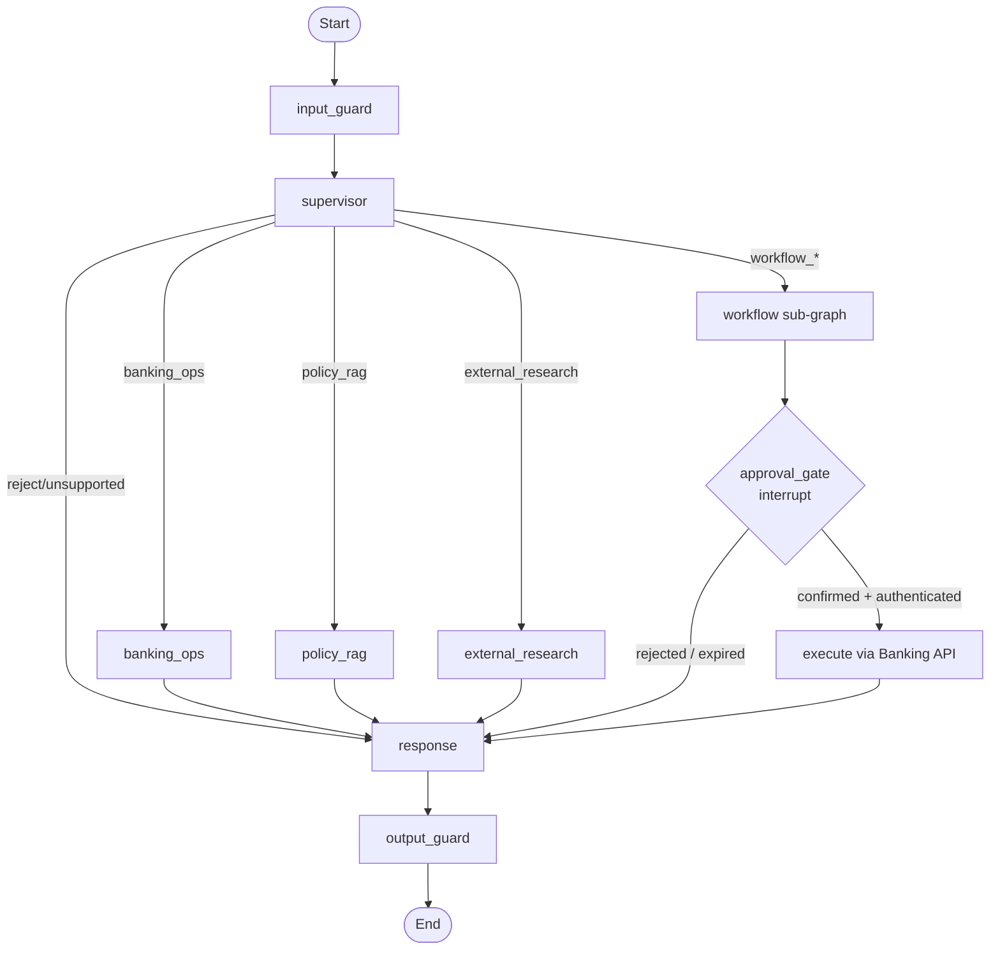

# Agent Architecture (LangChain + LangGraph)

## 1. Graph state
```python
class GraphState(TypedDict):
    user_id: str                 # banking user id (from validated JWT, never from LLM)
    session_id: str
    conversation_id: str
    user_message: str
    intent: Intent | None        # enum below
    agent_route: Route | None
    messages: Annotated[list[AnyMessage], add_messages]   # masked content only
    tool_results: list[ToolResultRef]    # masked/summarised; no raw secrets
    pending_action: PendingAction | None # {workflow, banking_resource_id, summary_masked, summary_hash, stage}
    approval_status: Literal["NONE","PENDING","CONFIRMED","REJECTED","EXPIRED"]
    authentication_status: Literal["NONE","REQUIRED","COMPLETED","FAILED"]  # status only
    transaction_reference: str | None
    response: str | None
```
**Excluded from state:** JWTs (fetched per request from a request-scoped context, not checkpointed), passwords, PIN, OTP, full account/card numbers. The access token is injected into `BankingClient` via `config["configurable"]` at invoke/resume time and is not serialized by the checkpointer.

## 2. Intents and routes
`Intent`: `BANK_READ, BENEFICIARY_ADD, TRANSFER, LOAN_INFO, LOAN_APPLY, CARD_INFO, CARD_PAYMENT, POLICY_QA, EXTERNAL_INFO, SMALL_TALK_BANKING, UNSUPPORTED_BANKING, OUT_OF_DOMAIN`.
`Route`: `banking_ops, workflow_beneficiary, workflow_transfer, workflow_loan, workflow_card_payment, policy_rag, external_research, reject_out_of_domain, unsupported`.

| Query | Intent | Route |
|---|---|---|
| What is my account balance? | BANK_READ | banking_ops |
| Show my last 10 transactions | BANK_READ | banking_ops |
| Add a new beneficiary | BENEFICIARY_ADD | workflow_beneficiary (HITL) |
| Transfer ₹5,000 to Rahul | TRANSFER | workflow_transfer (HITL) |
| Show my pre-approved loans | LOAN_INFO | banking_ops |
| Apply for a personal loan | LOAN_APPLY | workflow_loan (confirmation) |
| What is the bank's loan policy? | POLICY_QA | policy_rag |
| What is the RBI repo rate? | EXTERNAL_INFO | external_research |
| Explain Python decorators | OUT_OF_DOMAIN | reject_out_of_domain |
| What are my credit card dues? | CARD_INFO | banking_ops |
| Pay my credit card bill | CARD_PAYMENT | workflow_card_payment (HITL) |

**Routing rules (deterministic overlay on LLM output):**
1. Any customer-specific question → banking route, never RAG/external.
2. If no matching banking tool exists → `unsupported` response ("not currently available"), no simulation.
3. Bank-specific policy → RAG; if retrieval below threshold → "I couldn't find this in the available documents", **no fallback to web for bank policy**.
4. General finance (rates, concepts) → external research, labelled as non-official.
5. Mixed requests are split into sequential sub-tasks (max 3).
6. Low-confidence classification → ask one clarifying question.

## 3. Nodes
| Node | Type | Notes |
|---|---|---|
| `input_guard` | code | length limits, strip control chars, injection heuristics flag, PII-secret detector (if message looks like PIN/OTP/password → refuse and warn, do not store) |
| `supervisor` | LLM, structured output | `{intent, route, confidence, needs_api, needs_docs, needs_web, needs_approval}`; **no tools** |
| `banking_ops` | LLM + READ tools | Reads only; plus `prepare_*` tools in workflow sub-graphs |
| `workflow_*` | sub-graphs | collect → validate → prepare (draft at banking) → `approval_gate` → execute → report |
| `policy_rag` | retrieval + LLM | grounded, cites doc/version/page |
| `external_research` | search tool + LLM | allow-list, URLs, disclaimer |
| `approval_gate` | code | persists `PendingApproval`, calls `interrupt()` |
| `execute_*` | code | calls banking execute API with `authorization_id` and `summary_hash` from stored approval (not LLM) |
| `response` | LLM + template | composes, runs `output_guard` (masking, no secrets, no unsupported claims) |

## 4. Graph (simplified)


## 5. Tool registry
```python
ToolSpec(name, description, args_schema(pydantic), risk: READ|WRITE_LOW|SENSITIVE|FINANCIAL,
         requires_approval: bool, handler, allowed_nodes: set[str])
```
| Tool | Banking endpoint | Risk | LLM-callable? |
|---|---|---|---|
| list_accounts / get_balance | GET /accounts, /balance | READ | yes (banking_ops) |
| list_transactions | GET /transactions | READ | yes |
| list_beneficiaries / find_beneficiary | GET /beneficiaries | READ | yes |
| list_loan_offers / check_eligibility | GET /loans/... POST eligibility | READ | yes |
| list_cards / card_outstanding / current_bill | GET /credit-cards/... | READ | yes |
| prepare_transfer | POST /transfers | FINANCIAL (draft) | workflow only |
| execute_transfer | POST /transfers/{id}/execute | FINANCIAL | **no**, code node only after approval |
| create_beneficiary | POST /beneficiaries | SENSITIVE | **no**, code node only |
| submit_loan | POST /loans/applications | FINANCIAL | no, code node only |
| prepare/execute_card_payment | POST /credit-cards/... | FINANCIAL | same as transfer |
| rag_search | internal retriever | READ | yes (policy_rag) |
| web_search | provider API | READ-external | yes (external_research) |

Arguments validated by pydantic; `user_id` is never an LLM-supplied argument.

## 6. Interrupt/resume
- `approval_gate` calls `interrupt(payload)` where payload contains only masked summary + approval_id.
- Checkpointer: LangGraph `SqliteSaver` (AI DB). Thread id = `conversation_id`.
- Resume triggered only by `/chat/approvals/{id}/decision` (CONFIRM/REJECT) and `/resume` (after PIN completion), which call `graph.invoke(Command(resume={...}), config)`.
- Resume payload is verified against stored `PendingApproval` (owner, status, expiry, summary_hash).
- Expiry sweeper marks `EXPIRED`, cancels the draft at banking, closes the thread.
- If the user sends a new chat message while an approval is pending, the pending action is not changed; the assistant reminds the user to confirm or reject (or cancel via explicit control). Changing amount/beneficiary → new draft + new approval.

## 7. Prompt-injection defences in the graph
- System prompts separated from untrusted content; retrieved/web content wrapped in delimiters and labelled "data, not instructions".
- Tool authorization decided by code (`allowed_nodes`, `risk`), not by prompt.
- Output guard blocks attempts to emit secrets or fabricated account data (data present in answer must trace to a tool result).
- Supervisor has no tools; RAG/external nodes have no banking tools.

## 8. Configuration
`LLM_PROVIDER, LLM_MODEL, LLM_TEMPERATURE=0 (supervisor), EMBEDDING_PROVIDER, EMBEDDING_MODEL, VECTOR_STORE=chroma|faiss, RAG_TOP_K, RAG_MIN_SCORE, SEARCH_PROVIDER, SEARCH_ALLOWED_DOMAINS`.

## 9. Observability
Each node writes an `agent_execution` row (node, route, tool, latency, status, masked args). Admin dashboard reads these.
