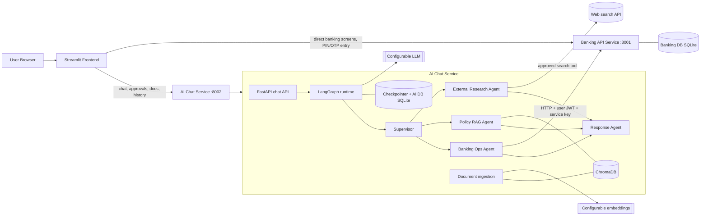

# Architecture

## 1. Style
Modular monolith per service, with **two backend deployables** and one UI, each with its own database:

1. **Banking API Service** (port 8001): owns all financial data and rules.
2. **AI Chat Service** (port 8002): agent orchestration, conversations, RAG (document service is a module inside it, with its own router and package boundary), workflow state.
3. **Streamlit Frontend** (port 8501): presentation only.

No shared database, ORM models, or repositories between services. Shared code is limited to a tiny `common` package (config helpers, logging, error schema), never domain models.

## 2. Component diagram

## 3. Service boundaries

| Concern | Banking Service | AI Service |
|---|---|---|
| Users, passwords, JWT issuance | Owner | Validates JWT via shared public key/JWKS (or introspection) |
| Money, balances, limits | Owner | Never |
| Transfer authorization (PIN/OTP) | Owner | Never sees secrets |
| Conversations, messages | None | Owner |
| Pending approvals | Transfer authorizations (financial) | Workflow approvals (conversation) |
| Documents, vectors | None | Owner |
| Audit log | Financial/security events | Agent/approval/document events |

## 4. Communication
- **Streamlit → AI service:** chat, resume/reject approvals, history, documents, admin AI monitoring.
- **Streamlit → Banking service:** direct screens, **PIN/OTP submission** (so secrets bypass AI service, LLM, and logs).
- **AI service → Banking service:** HTTPS REST through a single `BankingClient` adapter using the user's access token (user-delegated) plus `X-Service-Key` identifying the AI service. Banking enforces user ownership from the token, ignoring any user ID passed in a body.
- **AI → external search:** via a Tool Registry entry with allow-listed domains.

## 5. Agent orchestration (summary)
Supervisor classifies intent and picks a route; specialist nodes run; Response node composes the final answer. Money/beneficiary/loan/card-payment flows pass through an `approval_gate` node using LangGraph `interrupt()`. Details in `agent_architecture.md`.

## 6. Key decisions
| Decision | Rationale |
|---|---|
| Two DBs | Enforce ownership; mirrors future microservices |
| Banking validates everything | LLM is untrusted |
| PIN entered in UI → Banking directly | Keeps secrets out of LLM/graph/logs |
| Authorization token bound to `summary_hash` | Prevents bait-and-switch after confirmation |
| Idempotency keys on all money writes | Safe retries and resume |
| LangGraph SQLite checkpointer in AI DB | Resumable HITL; no secrets in state |
| ChromaDB default | Persistence + metadata filtering (FAISS via adapter) |
| Strategy/Factory for LLM, embeddings, vector store | Provider independence |

## 7. Patterns used
Repository, Service Layer, Unit of Work (banking writes), Factory (LLM/embeddings/vector store), Strategy (limits, fee calc, loan eligibility rules, chunkers), Adapter (BankingClient, search tool), Dependency Injection (FastAPI `Depends`), State Machine (transfer states, approval states), Tool Registry (agent tools with scope, risk level, schema).

## 8. Cross-cutting
- Correlation ID (`X-Request-ID`) across all hops and agent executions.
- Structured JSON logging with a masking filter.
- Consistent error envelope (see API spec).
- Config via pydantic-settings; secrets from env/secret files.

## 9. Production migration path (SQLite → PostgreSQL)
1. SQLAlchemy 2.x with no SQLite-specific SQL; use `Numeric` for money (stored as integer minor units).
2. Alembic migrations run against PostgreSQL in CI.
3. Replace `BEGIN IMMEDIATE`/WAL assumptions with row-level locking (`SELECT ... FOR UPDATE`) for balance updates.
4. Move LangGraph checkpointer to Postgres saver.
5. Add Redis for rate limiting, token denylist, idempotency cache.
6. Introduce secrets manager, TLS termination, mTLS between services.
7. Compliance assessment before any real deployment.
