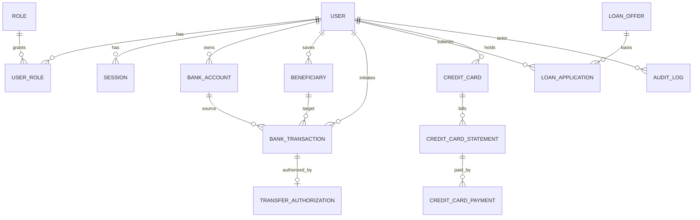
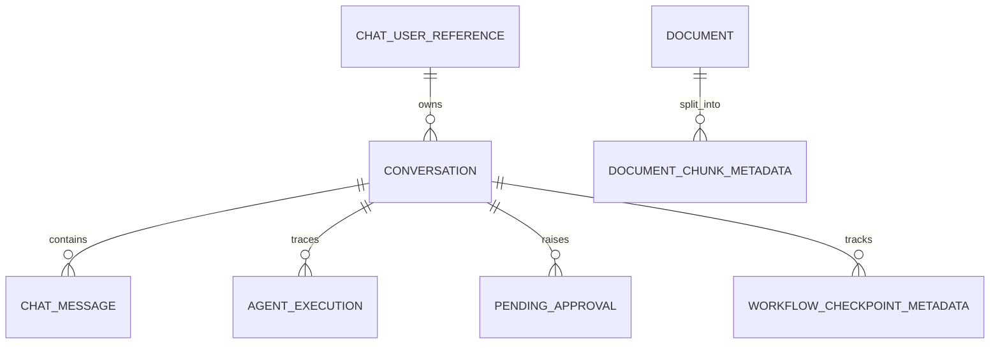

# Database Design

Conventions: UUID (string) primary keys, `created_at`/`updated_at` (UTC), money as **integer minor units (paise)** + `currency`, soft delete via `status`/`deleted_at` where noted. SQLite: `PRAGMA foreign_keys=ON`, WAL mode.

## 1. Banking DB ERD

## 2. Banking tables (key columns)

**user**: id, email (UQ), phone (UQ), full_name, password_hash (Argon2), transaction_pin_hash, is_active, failed_login_count, locked_until, last_login_at.
**role**: id, name (UQ: CUSTOMER, ADMIN, AUDITOR). **user_role**: user_id FK, role_id FK, PK(user_id, role_id).
**session** (refresh token): id, user_id FK, refresh_token_hash (UQ), jti, user_agent, ip, expires_at, revoked_at. Index(user_id, revoked_at).
**bank_account**: id, user_id FK idx, holder_name, account_number_encrypted, account_number_last4, account_number_hash (UQ with user_id), ifsc, bank_name, branch_name, account_type (SAVINGS/CURRENT), balance_minor, currency, verification_status (PENDING/VERIFIED/FAILED), status (ACTIVE/INACTIVE), created_at.
**beneficiary**: id, user_id FK idx, name, nickname, account_number_encrypted, last4, account_hash, ifsc, bank_name, verification_status, approval_status, status, UQ(user_id, account_hash, ifsc).
**bank_transaction**: id, reference (UQ), user_id FK idx, source_account_id FK, beneficiary_id FK, type (TRANSFER, CARD_PAYMENT, CREDIT, DEBIT), amount_minor, fee_minor, total_debit_minor, currency, status (PENDING_APPROVAL, AUTHORIZED, PROCESSING, COMPLETED, FAILED, CANCELLED), summary_hash, idempotency_key, failure_reason, expires_at, executed_at. **UQ(user_id, idempotency_key)**. Indexes: (user_id, created_at), (user_id, status), (beneficiary_id).
**transfer_authorization**: id, transaction_id FK UQ, method (PIN/OTP), challenge_hash, summary_hash, status (ISSUED/VERIFIED/CONSUMED/EXPIRED/LOCKED), attempts, expires_at, consumed_at. No raw secrets stored.
**loan_offer**: id, user_id FK nullable (pre-approved per user), loan_type, max_amount_minor, rate_bps, min/max_tenure_months, valid_till, status.
**loan_application**: id, reference (UQ), user_id FK, offer_id FK null, loan_type, amount_minor, tenure_months, rate_bps, employment_type, employer, monthly_income_minor, status (SUBMITTED, UNDER_REVIEW, APPROVED, REJECTED), decision_reason, idempotency_key (UQ with user_id).
**credit_card**: id, user_id FK, card_token, last4, network, credit_limit_minor, outstanding_minor, status. (No PAN/CVV stored at all.)
**credit_card_statement**: id, card_id FK, period_start/end, total_due_minor, min_due_minor, due_date, status.
**credit_card_payment**: id, reference (UQ), card_id FK, statement_id FK, source_account_id FK, amount_minor, status, idempotency_key (UQ with user_id), transaction_id FK.
**audit_log**: id, ts, actor_user_id, actor_type (USER/ADMIN/SERVICE), service, action, resource_type, resource_id, outcome, request_id, ip, details_json (masked), prev_hash/hash (optional chain). Append-only; no update/delete in app code. Index(actor_user_id, ts), (action, ts).

## 3. AI DB ERD

**chat_user_reference**: id, banking_user_id (UQ), role_snapshot, display_name_masked. (Reference only, no banking data.)
**conversation**: id, user_ref_id FK idx, title, status, created_at, updated_at, deleted_at.
**chat_message**: id, conversation_id FK idx, role (user/assistant/tool/system), content_masked, citations_json, created_at. Secrets never persisted.
**agent_execution**: id, conversation_id, message_id, node, route, tool_name, tool_args_masked, status, latency_ms, token_usage, error_code, request_id, created_at.
**pending_approval**: id, conversation_id FK, thread_id, workflow_type (BENEFICIARY/TRANSFER/LOAN/CARD_PAYMENT), risk_level, summary_masked_json, summary_hash, banking_resource_id (e.g., transaction id), status (PENDING, CONFIRMED, REJECTED, AUTH_REQUIRED, AUTHENTICATED, EXECUTED, EXPIRED, CANCELLED), expires_at, decided_at. Index(status, expires_at).
**document**: id, name, category, version, doc_group_id, status (UPLOADED, PROCESSING, READY, FAILED, INACTIVE), active, sha256, mime, size_bytes, uploaded_by, uploaded_at, error. UQ(doc_group_id, version).
**document_chunk_metadata**: id, document_id FK idx, chunk_index, vector_id, page, section, token_count.
**workflow_checkpoint_metadata**: thread_id (PK), conversation_id FK, checkpoint_id, last_node, status, expires_at, cleaned_at. (Actual checkpoints are in the LangGraph saver tables.)

## 4. Transaction boundaries
- Transfer **execute**: single DB transaction: lock source account row, re-check balance/limits/state, insert ledger entries, update balance, set `COMPLETED`, write audit row. On failure rollback and mark `FAILED` in a separate transaction.
- Idempotent replay returns the original result.

## 5. Retention / cleanup
- Expired approvals and pending transactions swept every minute (`EXPIRED`/`CANCELLED`).
- Checkpoints for finished/expired threads pruned after N days.
