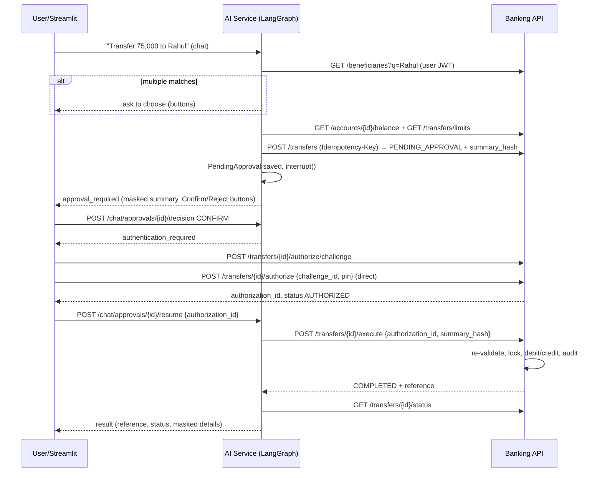

# Human-in-the-Loop Workflows

## 1. Action classification
| Class | Examples | Confirmation | Authentication | Backend enforcement |
|---|---|---|---|---|
| Information | balance, history, offers | no | no | JWT + ownership |
| Non-financial change | rename conversation, profile name | no (UI action) | no | JWT |
| Sensitive account change | add/modify beneficiary | yes | yes (PIN/OTP) | approval token bound to payload hash |
| Financial transaction | transfer, card payment | yes | yes (PIN/OTP) | AUTHORIZED state + summary_hash + single-use authorization |
| Loan submission | apply loan | yes (explicit) | per config (default: PIN) | confirmation record + eligibility re-check |
| High risk | change PIN/password, raise limits | not via chat; **UI-only** | password + OTP | AI service refuses and links to the settings screen |

## 2. Principles
1. **Confirmation ≠ authentication.** Two separate steps, two separate UI interactions.
2. Confirmation is a button press (`/chat/approvals/{id}/decision`), never parsed from free text ("yes" typed in chat does not confirm).
3. PIN/OTP is typed into a Streamlit secure widget and sent **directly to the Banking API**. It never traverses the AI service, LLM, graph state, checkpoints, logs, or vector DB.
4. Authorization is **bound to `summary_hash`** (txn id, user, source account, beneficiary, amount, fee, currency). Any change → new draft → new confirmation.
5. Backend independently verifies state, ownership, balance, limits, expiry, hash on execute.
6. Execution is idempotent: `Idempotency-Key = approval_id`.
7. Everything audited at both services.

## 3. Approval state machine (AI service)
```
PENDING --CONFIRM--> CONFIRMED --(auth required)--> AUTH_REQUIRED --authenticated--> AUTHENTICATED --execute--> EXECUTED
   |                     |                                |
   +--REJECT--> REJECTED +--expiry--> EXPIRED             +--lockout/expiry--> EXPIRED/CANCELLED
```
Expiry: transfer/card payment 5 min, beneficiary 10 min, loan 30 min (configurable). Sweeper every 60 s; on expiry the AI service calls banking `cancel` for any draft.

## 4. Transfer workflow

Steps map to the spec (1-11). Failure handling: insufficient funds/limit → explain, no draft; authorization failure → up to 3 attempts, then lock and cancel; backend `SUMMARY_MISMATCH` → abort and re-prepare; network timeout on execute → query status by idempotency key before retrying; never double-execute.

## 5. Beneficiary workflow
1. Collect fields conversationally or via form card (name, account number, IFSC, bank, nickname). Account number input is **sent as a form field from the UI to the AI service**, tokenised immediately; only masked values enter prompts/messages. (Alternative: UI form posts directly to banking to create a draft; chat only references the draft id. Recommended.)
2. Validate format; check duplicates through banking API.
3. Show masked review card.
4. Confirm (button) → authenticate (PIN/OTP direct to banking `/approvals/challenges/{id}/verify`) → approval token.
5. `POST /beneficiaries` with `X-Approval-Token` (bound to payload hash, single use).
6. Banking runs verification (mock), activates, audits. Return result.
No beneficiary row is created before approval. Optional cooling period before first transfer to a new beneficiary (configurable, default off in demo).

## 6. Loan application workflow
1. `GET /loans/offers` → display.
2. Collect missing fields (amount, tenure, employment, income) with schema validation.
3. `POST /loans/eligibility` (backend decides).
4. Summary card → user Confirm (button) → backend creates `confirmation_id`.
5. `POST /loans/applications` (Idempotency-Key, confirmation_id). Backend re-validates.
6. Return application reference and status.

## 7. Credit card bill payment
Same as transfer: `POST /credit-cards/{id}/payments` draft → confirm → authenticate → execute. Amount options (min due/total due/custom) are chosen before drafting.

## 8. Rejection / cancellation
Reject button → approval `REJECTED`, banking draft cancelled, graph resumed to the response node: "No action was taken."

## 9. Edge cases
- Browser closed mid-approval: approval persists until expiry; reopening the conversation shows the pending card.
- Two pending approvals: allow one per workflow type per conversation; new request supersedes after explicit confirmation.
- Resume from another session/user: rejected (owner check).
- Replay of `/resume`: idempotent; returns prior result.
- Admin cannot approve on behalf of a user.
