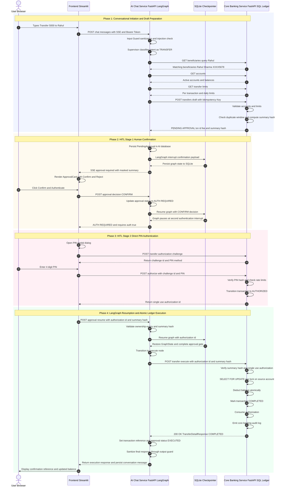

# Complete End-to-End Flow: Fund Transfer via AI Chat

This document details the complete end-to-end architecture, lifecycle, security invariants, state machines, and code flow for transferring money using the natural language AI chat interface in the **Local Banking AI Platform**.

---

## 1. Architectural Principles & Security Invariants

The fund transfer workflow is classified as a **Financial Transaction** and strictly adheres to the platform's Human-in-the-Loop (HITL) security architecture:

1. **Confirmation ≠ Authentication (Two Separate Stages)**:
   - **Stage 1 (Confirmation)**: The user inspects a structured, masked summary card and clicks **Confirm** or **Reject**. Confirmation is **never parsed from free-text chat** (typing *"yes, send it"* in chat will never trigger execution).
   - **Stage 2 (Authentication)**: The user enters their 4-to-6 digit Transaction PIN into a secure Streamlit dialog.
2. **Direct-to-Banking Credential Submission (Strict Security Invariant)**:
   - The user's transaction PIN is transmitted **directly from the client/browser to the Core Banking API** (`POST /transfers/{id}/authorize`).
   - The PIN **NEVER** touches, passes through, or gets logged by:
     - The AI Chat Service
     - LLM context windows or prompts
     - LangGraph `GraphState`
     - SQLite checkpoint tables (`checkpoints`, `checkpoint_blobs`)
     - Chat history or application logs
     - ChromaDB / Vector databases
3. **Cryptographic Binding via `summary_hash`**:
   - The Banking API calculates an immutable SHA-256 hash of the critical transaction parameters:
     ```json
     {"amount_minor": 500000, "beneficiary_id": "...", "currency": "INR", "fee_minor": 0, "source_account_id": "...", "txn_id": "...", "user_id": "..."}
     ```
   - Any modification to amounts, accounts, or recipient invalidates the hash and aborts execution with `SUMMARY_MISMATCH`.
4. **Strict Idempotency**:
   - Both drafting (`POST /transfers`) and final execution (`POST /transfers/{id}/execute`) enforce unique `Idempotency-Key` headers to guarantee no duplicate transfers occur during network retries.
5. **Pessimistic Row Locking & Atomic Execution**:
   - Account balances are deducted within an isolated database transaction using `SELECT ... FOR UPDATE` row locks.
6. **Dual-Layer Audit Logging**:
   - Every action (drafting, challenge generation, authorization, execution, cancellation) is recorded in immutable audit tables in both the AI and Banking databases.

---

## 2. End-to-End Sequence Diagram



---

## 3. State Machines

### 3.1. Banking Transaction State Machine
Defined in `banking_service/app/services/transfer_state.py`:

```
               +--------------------------------------+
               |                                      |
               v                                      |
       [PENDING_APPROVAL]                             |
         /     |       \                              |
        /      |        +----> [CANCELLED] (User/UI)  |
       /       +-------------> [EXPIRED]   (Timeout)  |
      v                                               |
 [AUTHORIZED] -----------------> [CANCELLED]          |
      |                                               |
      v                                               |
 [PROCESSING] (DB Lock Acquired)                      |
      |     \                                         |
      |      +---------------> [FAILED] (Error/Drift) |
      v                                               |
 [COMPLETED]                                          |
```

### 3.2. AI Service Approval State Machine
Defined in `ai_service/app/models/approval.py`:

```
 [PENDING] --------------------+----> [REJECTED]   (User click)
    |                          |
    | (Confirm clicked)        +----> [EXPIRED]    (TTL 5m timeout)
    v                          |
 [CONFIRMED]                   +----> [SUPERSEDED] (New request created)
    |
    v (Financial workflow)
 [AUTH_REQUIRED]
    |
    v (Direct PIN verified at Banking API)
 [AUTHENTICATED]
    |
    v (Executed via execute_node)
 [EXECUTED]
```

---

## 4. Complete Flow of Code (Step-by-Step)

### Step 1: User Initiates Transfer Request in Chat

**Location**: `frontend/pages/1_Chat.py`

When the user types `"Transfer ₹5,000 to Rahul"` into the Streamlit chat box, the client sends an SSE streaming request to the AI Chat Service:

```python
# frontend/pages/1_Chat.py (Excerpt)

user_prompt = st.chat_input("Type your message or banking instruction...")

if user_prompt:
    st.session_state.chat_messages.append({"role": "user", "content": user_prompt})
    with st.chat_message("user"):
        st.markdown(user_prompt)

    with st.chat_message("assistant"):
        stream_placeholder = st.empty()
        full_response = ""

        with st.status("🧠 Processing your request...", expanded=True) as status_box:
            # Streams events from AI Service SSE endpoint: POST /api/v1/chat/messages
            event_stream = ai_client.stream_message(
                message=user_prompt,
                conversation_id=st.session_state.active_conversation_id,
                access_token=token or "",
            )

            for event in event_stream:
                evt_type = event.get("event")
                evt_data = event.get("data")

                if evt_type == "approval_required":
                    status_box.update(label="⚠️ Human Approval Required", state="running", expanded=False)
                    st.session_state.pending_approval = evt_data

                elif evt_type == "token":
                    full_response += evt_data.get("token", "")
                    stream_placeholder.markdown(full_response + "▌")

                elif evt_type == "done":
                    if evt_data.get("conversation_id"):
                        st.session_state.active_conversation_id = evt_data.get("conversation_id")
                    status_box.update(label="Response complete", state="complete", expanded=False)

            if st.session_state.pending_approval:
                st.rerun()  # Forces immediate rendering of Approval Card
```

---

### Step 2: AI Input Guard & Supervisor Intent Classification

**Location**: `ai_service/app/agents/guards/input_guard.py` & `ai_service/app/agents/nodes/supervisor.py`

1. The message enters the graph at `input_guard_node`, where regex patterns check for prompt injection, jailbreaks, and mask sensitive numbers.
2. The sanitized message is routed to `supervisor_node`, which performs LLM classification and applies deterministic routing overrides:

```python
# ai_service/app/agents/nodes/supervisor.py (Excerpt)

ROUTE_OVERRIDES: dict[str, Route] = {
    "TRANSFER": "workflow_transfer",
    "BANK_READ": "banking_ops",
    "BENEFICIARY_ADD": "workflow_beneficiary",
    # ...
}

def supervisor_node(state: GraphState, config: RunnableConfig = None) -> dict:
    user_msg = state.get("user_message", "")
    
    # LLM Structured Prompting classifies user_msg as Intent="TRANSFER"
    # Deterministic override forces route to "workflow_transfer"
    return {
        "intent": "TRANSFER",
        "agent_route": "workflow_transfer",
        "route_confidence": 1.0,
    }
```

---

### Step 3: Transfer Workflow Node — Parsing, Validation & Draft Creation

**Location**: `ai_service/app/agents/workflows/transfer.py`

The `workflow_transfer_node` executes in the AI Service. It extracts the parameters, performs conversational slot-filling, checks beneficiary and limits against the Banking API, and drafts the transfer:

```python
# ai_service/app/agents/workflows/transfer.py (Excerpt)

def workflow_transfer_node(state: GraphState, config: RunnableConfig) -> dict[str, Any]:
    user_msg = state.get("user_message", "")
    messages = state.get("messages", [])
    
    # 1. Regex parsing of amounts (converts INR to minor units / paise)
    extracted = extract_transfer_fields(user_msg, messages)
    amount_minor = extracted.get("amount_minor")       # e.g., 500000 (5,000 INR)
    bene_name = extracted.get("beneficiary_name")      # e.g., "Rahul"
    channel = extracted.get("channel", "IMPS")
    remark = extracted.get("remark") or "Fund Transfer"

    # Conversational slot filling: prompt if fields are missing
    if not amount_minor or not bene_name:
        # Prompt user conversationally for missing details
        ...

    cfg = config.get("configurable", {}) if config else {}
    access_token = cfg.get("access_token", "")
    client = BankingClient(settings=get_settings(), access_token=access_token)

    # 2. Beneficiary Lookup via Core Banking API
    benes = client.list_beneficiaries(q=bene_name)
    if not benes:
        msg = f"I couldn't find any beneficiary matching '**{bene_name}**'."
        return {"response": msg, "messages": [AIMessage(content=msg)]}
    target_bene = benes[0]

    # 3. Source Account Selection & Balance Check
    accounts = client.list_accounts()
    active_accounts = [a for a in accounts if a.get("status") == "ACTIVE"]
    source_acc = next((a for a in active_accounts if a.get("balance_minor", 0) >= amount_minor), None)
    if not source_acc:
        msg = "Insufficient balance in your accounts to initiate this transfer."
        return {"response": msg, "messages": [AIMessage(content=msg)]}

    # 4. Limits Check
    limits = client.get_transfer_limits()
    if amount_minor > limits.get("per_transaction_limit_minor", float("inf")):
        return {"response": "Transfer amount exceeds your per-transaction transfer limit."}

    # 5. Call Core Banking API to Prepare Transfer Draft (PENDING_APPROVAL)
    idempotency_key = str(uuid.uuid4())
    draft_payload = {
        "source_account_id": source_acc["id"],
        "beneficiary_id": target_bene["id"],
        "amount_minor": amount_minor,
        "currency": "INR",
        "remark": remark,
        "channel": channel,
    }
    draft = client.prepare_transfer(draft_payload, idempotency_key=idempotency_key)

    txn_id = draft.get("id")
    summary_hash = draft.get("summary_hash", "")
    fee_minor = draft.get("fee_minor", 0)
    total_debit_minor = draft.get("total_debit_minor", amount_minor + fee_minor)

    # 6. Assemble PendingAction for the Approval Gate
    summary_masked = {
        "beneficiary": target_bene["name"],
        "account_masked": target_bene.get("account_number_masked", "XXXX"),
        "amount": format_inr(amount_minor),
        "charges": format_inr(fee_minor),
        "total_debit": format_inr(total_debit_minor),
        "reference": draft.get("reference", ""),
    }

    pending_action: PendingAction = {
        "workflow": WorkflowType.TRANSFER.value,
        "banking_resource_id": txn_id,
        "summary_masked": summary_masked,
        "summary_hash": summary_hash,
        "stage": "CONFIRM",
        "action_data": {
            "txn_id": txn_id,
            "summary_hash": summary_hash,
            "idempotency_key": idempotency_key,
        },
    }

    return {
        "pending_action": pending_action,
        "approval_status": ApprovalStatus.PENDING.value,
        "authentication_status": "NONE",
        "response": f"Please review the transfer details to {target_bene['name']}...",
    }
```

---

### Step 4: Core Banking Draft Preparation

**Location**: `banking_service/app/services/transfer_service.py`

When the AI Service calls `POST /api/v1/transfers`, the Banking Service executes `TransferService.prepare`:

```python
# banking_service/app/services/transfer_service.py (Excerpt)

@staticmethod
def prepare(
    user_id: str,
    data: PrepareTransferRequest,
    idempotency_key: str,
    db: Session,
    settings: BankingSettings,
    request_id: Optional[str] = None,
    ip: Optional[str] = None,
) -> BankTransaction:
    # 1. Idempotency check: return existing if replay
    repo = TransactionRepository(db)
    existing = repo.get_by_idempotency_key(user_id, idempotency_key)
    if existing and existing.status not in ["EXPIRED", "CANCELLED"]:
        return existing

    # 2. Source Account validation
    source_account = db.scalar(
        select(BankAccount).where(BankAccount.id == data.source_account_id, BankAccount.user_id == user_id)
    )
    if not source_account or source_account.status != "ACTIVE":
        raise ConflictError("Source bank account is not ACTIVE")

    # 3. Beneficiary validation
    beneficiary = db.scalar(
        select(Beneficiary).where(Beneficiary.id == data.beneficiary_id, Beneficiary.user_id == user_id)
    )
    if not beneficiary or beneficiary.approval_status != "APPROVED":
        raise BankingError(error_code="BENEFICIARY_NOT_APPROVED", message="Beneficiary not approved", http_status=422)

    # 4. Fee & Balance check
    fee_minor = FeeStrategy.calculate_fee(data.channel, data.amount_minor)
    total_debit_minor = data.amount_minor + fee_minor
    if source_account.balance_minor < total_debit_minor:
        raise BankingError(error_code="INSUFFICIENT_BALANCE", message="Insufficient balance", http_status=422)

    # 5. Limits & Duplicate Window check
    LimitsService.check_limits(user_id, data.amount_minor, repo, settings)
    duplicate = repo.check_duplicate_window(user_id, data.beneficiary_id, data.amount_minor, settings.duplicate_window_seconds)
    if duplicate:
        raise BankingError(error_code="DUPLICATE_TRANSACTION", message="Duplicate transfer detected", http_status=409)

    # 6. Generate IDs & Compute Cryptographic summary_hash
    txn_id = str(uuid.uuid4())
    reference = f"TXN{datetime.now(timezone.utc).strftime('%Y%m%d%H%M%S')}{secrets.token_hex(2).upper()}"
    summary_payload = {
        "amount_minor": data.amount_minor,
        "beneficiary_id": data.beneficiary_id,
        "currency": data.currency,
        "fee_minor": fee_minor,
        "source_account_id": data.source_account_id,
        "txn_id": txn_id,
        "user_id": user_id,
    }
    summary_hash = sha256_hash(json.dumps(summary_payload, sort_keys=True))
    expires_at = datetime.now(timezone.utc) + timedelta(seconds=settings.transfer_approval_expiry_seconds)

    # 7. Persist BankTransaction with status PENDING_APPROVAL
    txn = BankTransaction(
        id=txn_id,
        reference=reference,
        user_id=user_id,
        source_account_id=data.source_account_id,
        beneficiary_id=data.beneficiary_id,
        type="TRANSFER",
        amount_minor=data.amount_minor,
        fee_minor=fee_minor,
        total_debit_minor=total_debit_minor,
        currency=data.currency,
        status="PENDING_APPROVAL",
        summary_hash=summary_hash,
        idempotency_key=idempotency_key,
        expires_at=expires_at,
    )
    db.add(txn)
    db.flush()

    # 8. Record audit log
    AuditService.log(db, actor_user_id=user_id, action="TRANSFER_PREPARE", resource_id=txn.id, outcome="SUCCESS")
    return txn
```

---

### Step 5: Approval Gate Node & LangGraph `interrupt()`

**Location**: `ai_service/app/agents/nodes/approval_gate.py`

The graph transitions to `approval_gate_node`. It saves the approval record in the AI Service database and calls `interrupt()`, which halts execution and persists state into the SQLite checkpointer:

```python
# ai_service/app/agents/nodes/approval_gate.py (Excerpt)

def approval_gate_node(state: GraphState, config: RunnableConfig) -> dict[str, Any]:
    pending_action = state.get("pending_action")
    if not pending_action:
        return {}

    # 1. Save PendingApproval record in AI Service DB
    session_factory = get_session_factory()
    with session_factory() as db:
        service = ApprovalService(db)
        approval = service.create_approval(
            conversation_id=conv_id,
            thread_id=thread_id,
            workflow_type=WorkflowType.TRANSFER.value,
            summary_masked=pending_action.get("summary_masked", {}),
            summary_hash=pending_action.get("summary_hash", ""),
            banking_resource_id=pending_action.get("banking_resource_id"),
        )
        approval_id = approval.id

    # 2. Stage 1 Interrupt: Wait for Human Decision (CONFIRM / REJECT)
    if state.get("approval_status") == ApprovalStatus.PENDING.value:
        confirm_payload = {
            "approval_id": approval_id,
            "workflow": "TRANSFER",
            "stage": "CONFIRM",
            "summary": pending_action.get("summary_masked", {}),
            "summary_hash": pending_action.get("summary_hash", ""),
            "banking_resource_id": pending_action.get("banking_resource_id"),
            "expires_at": approval.expires_at.isoformat(),
        }

        # Halts execution here; persists state in SQLite checkpointer
        decision_raw = interrupt(confirm_payload)

        # Execution resumes here once POST /chat/approvals/{id}/decision is called
        decision = decision_raw.get("decision", "CONFIRM") if isinstance(decision_raw, dict) else decision_raw
        if str(decision).upper() == "REJECT":
            return {
                "approval_id": approval_id,
                "approval_status": ApprovalStatus.REJECTED.value,
                "response": "No action was taken. The transfer request has been cancelled.",
            }

    # 3. Stage 2 Interrupt: Wait for Direct PIN Authorization ID
    if state.get("authentication_status") != "COMPLETED":
        auth_payload = {
            "approval_id": approval_id,
            "workflow": "TRANSFER",
            "stage": "AUTH_REQUIRED",
            "banking_resource_id": pending_action.get("banking_resource_id"),
            "summary_hash": pending_action.get("summary_hash", ""),
        }
        
        # Halts execution waiting for POST /chat/approvals/{id}/resume
        auth_raw = interrupt(auth_payload)
        auth_id = auth_raw.get("authorization_id") if isinstance(auth_raw, dict) else str(auth_raw)

        return {
            "approval_id": approval_id,
            "approval_status": ApprovalStatus.CONFIRMED.value,
            "authentication_status": "COMPLETED",
            "authorization_id": auth_id,
        }
```

---

### Step 6: Frontend HITL Stage 1 — Confirmation Card

**Location**: `frontend/components/approval_card.py` & `ai_service/app/services/approval_service.py`

The SSE stream emits `event: approval_required`. Streamlit renders a structured review card:

```python
# frontend/components/approval_card.py (Excerpt)

def render_approval_card(approval_data: dict[str, Any]) -> None:
    approval_id = approval_data.get("approval_id")
    summary = approval_data.get("summary", {})

    with st.container(border=True):
        st.subheader("💸 Fund Transfer Confirmation")
        
        # Display transaction breakdown
        cols = st.columns(3)
        cols[0].metric("Amount", summary.get("amount"))
        cols[1].metric("Total Debit", summary.get("total_debit"))
        cols[2].metric("Beneficiary", summary.get("beneficiary"))

        col_btn1, col_btn2 = st.columns(2)
        with col_btn1:
            if st.button("✅ Confirm & Authenticate", key=f"btn_confirm_{approval_id}", type="primary"):
                token = get_access_token()
                ai_client = get_ai_client()
                
                # 1. Post confirmation decision to AI Service
                dec_res = ai_client.decide_approval(approval_id, "CONFIRM", token)
                
                # 2. Trigger Stage 2 PIN Dialog
                render_pin_modal_dialog(approval_data)

        with col_btn2:
            if st.button("❌ Reject & Cancel", key=f"btn_reject_{approval_id}"):
                ai_client.decide_approval(approval_id, "REJECT", token)
                st.session_state.pending_approval = None
                st.rerun()
```

When `decide_approval(approval_id, "CONFIRM")` is called:
1. `ApprovalService.decide_approval` updates the database status to `AUTH_REQUIRED`.
2. It invokes `resume_graph(thread_id, Command(resume={"decision": "CONFIRM"}))`.
3. The graph advances from the Stage 1 interrupt and stops at the Stage 2 interrupt (`AUTH_REQUIRED`), waiting for `authorization_id`.

---

### Step 7: Frontend HITL Stage 2 — Direct PIN Authentication Dialog

**Location**: `frontend/components/pin_dialog.py`

The modal dialog prompts for the transaction PIN. The PIN is sent **directly to the Banking Service**:

```python
# frontend/components/pin_dialog.py (Excerpt)

@st.dialog("🔒 Enter Transaction PIN")
def render_pin_modal_dialog(approval_data: dict[str, Any]) -> None:
    approval_id = approval_data.get("approval_id")
    banking_resource_id = approval_data.get("banking_resource_id")
    summary_hash = approval_data.get("summary_hash")

    st.markdown("Please enter your **4-digit Transaction PIN** to authorize this transfer.")
    st.info("🛡️ Security Invariant: Your PIN is submitted directly to Core Banking and never touches AI Chat.")

    with st.form("pin_auth_form"):
        pin = st.text_input("Transaction PIN", type="password", max_chars=6)
        submitted = st.form_submit_button("Authorize & Execute", type="primary")

    if submitted:
        token = get_access_token()
        banking_client = get_banking_client()
        ai_client = get_ai_client()

        # Step A: Request challenge directly from Banking API
        challenge = banking_client.create_transfer_challenge(txn_id=banking_resource_id, access_token=token)
        challenge_id = challenge["challenge_id"]

        # Step B: Submit PIN directly to Banking API
        auth_res = banking_client.authorize_transfer(
            txn_id=banking_resource_id,
            challenge_id=challenge_id,
            pin=pin,
            access_token=token,
        )
        authorization_id = auth_res["authorization_id"]

        # Step C: Resume AI Graph with authorization_id (NO PIN OR SECRETS)
        resume_res = ai_client.resume_approval(
            approval_id=approval_id,
            authorization_id=authorization_id,
            access_token=token,
            summary_hash=summary_hash,
        )

        st.session_state.pending_approval = None
        st.success("Transfer completed successfully!")
        st.rerun()
```

---

### Step 8: Core Banking Challenge & PIN Verification

**Location**: `banking_service/app/services/transfer_service.py`

The Core Banking service verifies the PIN against the Argon2/bcrypt hash in the database:

```python
# banking_service/app/services/transfer_service.py (Excerpt)

@staticmethod
def authorize(
    user_id: str,
    txn_id: str,
    challenge_id: str,
    pin_or_otp: str | None,
    db: Session,
    settings: BankingSettings,
    request_id: Optional[str] = None,
    ip: Optional[str] = None,
) -> TransferAuthorization:
    repo = TransactionRepository(db)
    txn = repo.get_by_id(txn_id, user_id=user_id)
    if not txn or txn.status != "PENDING_APPROVAL":
        raise ConflictError(f"Transfer status is {txn.status}, cannot authorize")

    auth = repo.get_authorization_by_id(challenge_id)
    if not auth or auth.status != "ISSUED":
        raise ConflictError(f"Authorization is {auth.status}, cannot verify")

    user = db.scalar(select(User).where(User.id == user_id))
    
    # Verify Argon2/bcrypt PIN hash
    if not pin_or_otp or not verify_pin(pin_or_otp, user.transaction_pin_hash):
        attempts = auth.attempts + 1
        if attempts >= settings.txn_auth_max_attempts:  # Default: 3 attempts
            repo.update_authorization(auth.id, "LOCKED", attempts=attempts)
            raise BankingError(error_code="AUTHORIZATION_LOCKED", message="Max attempts exceeded. Locked.", http_status=423)
        repo.update_authorization(auth.id, "ISSUED", attempts=attempts)
        raise BankingError(error_code="AUTHORIZATION_INVALID", message="Invalid PIN", http_status=400)

    # Transition txn state machine from PENDING_APPROVAL -> AUTHORIZED
    transition(txn.status, "AUTHORIZED", context="transfer")
    repo.update_authorization(auth.id, "VERIFIED")
    repo.update_status(txn.id, "AUTHORIZED")

    AuditService.log(db, actor_user_id=user_id, action="TRANSFER_AUTHORIZE", resource_id=txn.id, outcome="SUCCESS")
    return auth
```

---

### Step 9: LangGraph Resumption via Authorization ID

**Location**: `ai_service/app/services/approval_service.py` & `ai_service/app/agents/graph.py`

The client calls `POST /api/v1/chat/approvals/{id}/resume` with `{authorization_id, summary_hash}`.

```python
# ai_service/app/services/approval_service.py (Excerpt)

def resume_approval(
    self,
    approval_id: str,
    authorization_id: str,
    banking_user_id: str,
    raw_token: str,
    summary_hash: str | None = None,
) -> dict[str, Any]:
    approval = self.get_approval(approval_id, banking_user_id=banking_user_id)

    # 1. Tamper check: summary_hash must match the draft's summary_hash
    if summary_hash and approval.summary_hash != summary_hash:
        raise ConflictError("Summary hash mismatch: transaction details have been tampered with")

    if approval.is_expired:
        raise ConflictError("Approval request has expired")

    approval.status = ApprovalStatus.AUTHENTICATED.value
    self.db.commit()

    # 2. Resume graph from SQLite checkpointer using Command(resume=...)
    from app.agents.graph import resume_graph
    exec_res = resume_graph(
        thread_id=approval.thread_id,
        resume_payload={"authorization_id": authorization_id, "approval_id": approval.id},
        access_token=raw_token,
    )

    approval.status = ApprovalStatus.EXECUTED.value
    self.db.commit()
    return {
        "approval_id": approval.id,
        "status": approval.status,
        "response": exec_res.get("response"),
    }
```

```python
# ai_service/app/agents/graph.py (Excerpt)

def resume_graph(thread_id: str, resume_payload: Any, access_token: str | None = None) -> dict[str, Any]:
    graph = get_graph()
    config = {
        "configurable": {
            "thread_id": thread_id,
            "access_token": access_token or "",
        }
    }
    cmd = Command(resume=resume_payload)
    return graph.invoke(cmd, config=config)
```

---

### Step 10: Execution Node & Atomic Ledger Debit

**Location**: `ai_service/app/agents/nodes/execute.py` & `banking_service/app/services/transfer_service.py`

#### 1. In AI Service (`execute_node`):
```python
# ai_service/app/agents/nodes/execute.py (Excerpt)

def execute_node(state: GraphState, config: RunnableConfig) -> dict[str, Any]:
    pending_action = state.get("pending_action")
    auth_token = state.get("authorization_id")
    access_token = config.get("configurable", {}).get("access_token", "")

    txn_id = pending_action.get("banking_resource_id")
    summary_hash = pending_action.get("summary_hash")
    summary = pending_action.get("summary_masked") or {}

    client = BankingClient(settings=get_settings(), access_token=access_token)

    # Calls Banking API: POST /api/v1/transfers/{txn_id}/execute
    exec_res = client.execute_transfer(
        txn_id=txn_id,
        authorization_id=auth_token,
        summary_hash=summary_hash,
        idempotency_key=f"exec-{txn_id}",
    )

    ref = exec_res.get("reference", txn_id)
    success_msg = (
        f"Transfer of **{summary.get('amount')}** to **{summary.get('beneficiary')}** "
        f"has been completed successfully.\n"
        f"- **Reference**: `{ref}`\n"
        f"- **Status**: `COMPLETED`"
    )

    return {
        "transaction_reference": ref,
        "response": success_msg,
        "messages": [AIMessage(content=success_msg)],
        "pending_action": None,
        "approval_status": ApprovalStatus.EXECUTED.value,
    }
```

#### 2. In Banking Service (`TransferService.execute`):
```python
# banking_service/app/services/transfer_service.py (Excerpt)

@staticmethod
def execute(
    user_id: str,
    txn_id: str,
    authorization_id: str,
    summary_hash: str,
    idempotency_key: str,
    db: Session,
    settings: BankingSettings,
    request_id: Optional[str] = None,
    ip: Optional[str] = None,
) -> BankTransaction:
    repo = TransactionRepository(db)
    txn = repo.get_by_id(txn_id, user_id=user_id)
    if not txn:
        raise NotFoundError("Transfer", txn_id)

    # 1. Idempotent return if already completed
    if txn.status == "COMPLETED":
        return txn

    # 2. Check status and summary_hash tamper verification
    if txn.status != "AUTHORIZED":
        raise ConflictError(f"Transfer status is {txn.status}; must be AUTHORIZED to execute")
    if txn.summary_hash != summary_hash:
        raise BankingError(error_code="SUMMARY_MISMATCH", message="Summary hash mismatch", http_status=409)

    # 3. Check single-use authorization
    auth = repo.get_authorization_by_id(authorization_id)
    if not auth or auth.status != "VERIFIED" or auth.transaction_id != txn.id:
        raise BankingError(error_code="AUTHORIZATION_INVALID", message="Invalid authorization", http_status=400)

    # 4. Atomic debit with pessimistic row lock (SELECT ... FOR UPDATE)
    account_stmt = select(BankAccount).where(BankAccount.id == txn.source_account_id).with_for_update()
    source_account = db.scalar(account_stmt)

    if source_account.balance_minor < txn.total_debit_minor:
        repo.update_status(txn.id, "FAILED", failure_reason="Insufficient balance at execution")
        raise BankingError(error_code="INSUFFICIENT_BALANCE", message="Insufficient balance", http_status=422)

    # 5. State transitions: AUTHORIZED -> PROCESSING -> COMPLETED
    transition(txn.status, "PROCESSING", context="transfer")
    repo.update_status(txn.id, "PROCESSING")

    # Atomic ledger deduction
    source_account.balance_minor -= txn.total_debit_minor

    transition("PROCESSING", "COMPLETED", context="transfer")
    executed_at = datetime.now(timezone.utc)
    repo.update_status(txn.id, "COMPLETED", executed_at=executed_at)
    
    # Invalidate authorization token so it can never be reused
    repo.update_authorization(auth.id, "CONSUMED", consumed_at=executed_at)

    # 6. Audit log
    AuditService.log(
        db=db,
        actor_user_id=user_id,
        action="TRANSFER_EXECUTE",
        resource_id=txn.id,
        outcome="SUCCESS",
        details={"reference": txn.reference, "amount_minor": txn.amount_minor, "fee_minor": txn.fee_minor},
    )
    return txn
```

---

### Step 11: Final Assistant Response & UI Display

The execution result flows into `response_node`, where `output_guard` ensures no leaks occur:

```python
# ai_service/app/agents/nodes/response.py (Excerpt)

def response_node(state: GraphState, config: RunnableConfig = None) -> dict:
    response = state.get("response") or "Transfer executed."
    final = run_output_guard(response)
    return {
        "response": final,
        "messages": [AIMessage(content=final)],
    }
```

The completed text is delivered to the user with the generated transaction reference:

```markdown
Transfer of **₹5,000.00** to **Rahul Sharma** (account ending in 5678) has been completed successfully.
- **Reference**: `TXN20261119112837A1B2`
- **Status**: `COMPLETED`
```

---

## 5. Security & Failure Recovery Mechanisms

| Scenario | System Defense / Handling |
|---|---|
| **User clicks "Reject"** | AI Service calls Banking API `POST /transfers/{id}/cancel`. Graph transitions to `response_node`: *"No action was taken. The transfer request has been cancelled."* |
| **User closes browser mid-approval** | State remains safely in SQLite checkpointer. On reopening the chat, `get_active_approval()` reloads and displays the active Approval Card. |
| **Approval timeout (5 minutes)** | The background `ExpirySweeperService` (every 60s) sweeps expired approvals, calls `cancel` on pending drafts, and updates status to `EXPIRED`. |
| **Incorrect PIN entered** | Throttled up to 3 attempts. On the 3rd failed attempt, status becomes `LOCKED` (`HTTP 423`), and the transfer draft is aborted. |
| **Payload tampering attempt** | The SHA-256 `summary_hash` is re-calculated in the Banking API upon execute. If any parameter was altered, it returns `HTTP 409 SUMMARY_MISMATCH`. |
| **Double execution / Network retry** | `Idempotency-Key` prevents duplicate drafts or duplicate executions. The `execute` method idempotently returns the completed transaction if repeated. |
| **PIN leakage prevention** | Frontend sends PIN exclusively to `banking_client.authorize_transfer`. Never passed to `ai_client` or LangGraph. |
